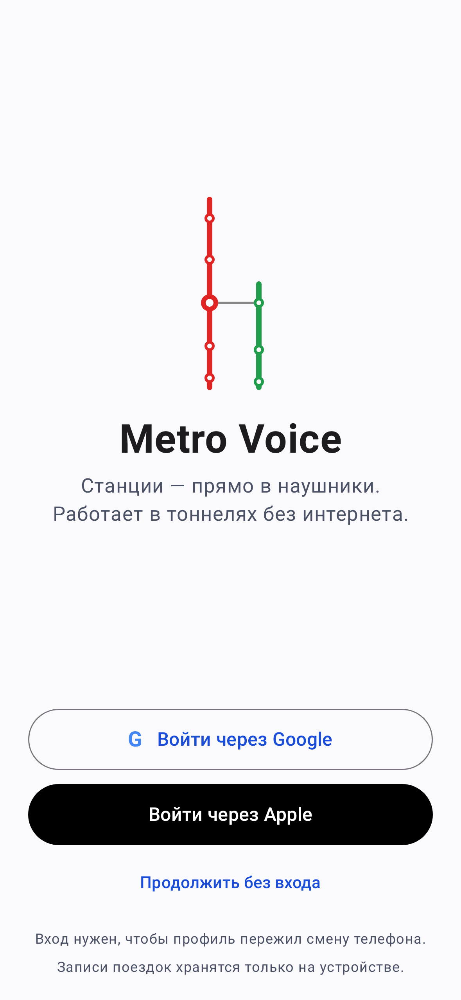
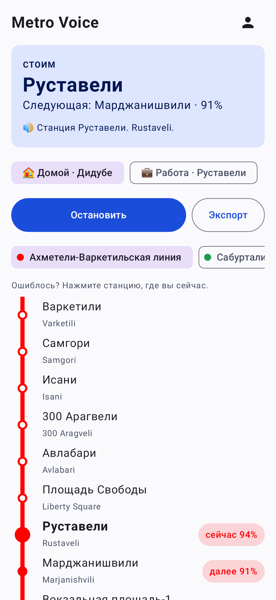
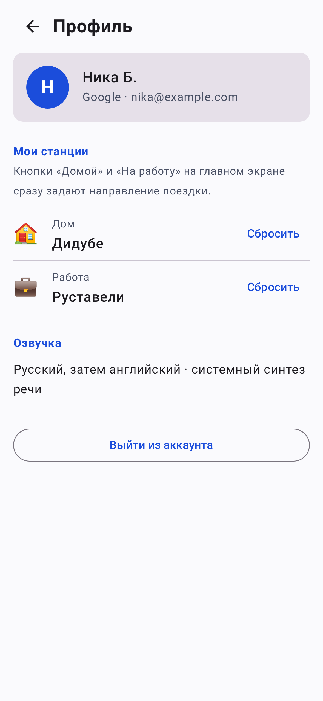

# Metro Voice

Навигатор по метро для ушей: говорит в наушники текущую и следующую станцию. Работает офлайн, без GPS под землёй: позиция выводится из сетевой геолокации на станциях, ритма поезда (акселерометр) и графа линии.

- Спецификация: [docs/SPEC.md](docs/SPEC.md)
- Рынок и конкуренты: [docs/MARKET.md](docs/MARKET.md)

## Структура

| Модуль | Что внутри |
|---|---|
| `core/` | Чистый Kotlin, без Android: граф метро, детектор движения, трекер гипотез (HMM), политика объявлений, формат записи поездки, импорт из OpenStreetMap. Тестируется на ноутбуке |
| `app/` | Android: foreground service (датчики, геолокация, соты, Wi-Fi → движок → голос), лента линии, экспорт поездки |

## Сборка

Нужны JDK 17+ и Android SDK (platform 35).

```bash
./gradlew :core:test                 # тесты ядра
./gradlew :app:assembleDebug         # APK: app/build/outputs/apk/debug/app-debug.apk
```

## Вход и профиль

Вход через Google и Apple — Firebase Authentication, настройка: [docs/AUTH_SETUP.md](docs/AUTH_SETUP.md). Без неё приложение работает в гостевом режиме. Профиль (станции «дом» и «работа») хранится на телефоне.

## Скриншоты

Рендерятся из настоящего Compose-кода на JVM (Robolectric + Roborazzi), без эмулятора:

```bash
./gradlew :app:recordRoborazziDebug   # → docs/screenshots/*.png
```

| | | |
|---|---|---|
|  |  |  |

## Данные города

1. Выгрузка из [overpass-turbo.eu](https://overpass-turbo.eu): запрос ниже → Export → raw OSM data → `data/osm/tbilisi-overpass.json`.
2. Конвертация в пакет города:

```bash
./gradlew :core:cli --args="import-osm data/osm/tbilisi-overpass.json app/src/main/assets/cities/tbilisi.json tbilisi"
```

Запрос Overpass:

```
[out:json][timeout:60];
{{geocodeArea:Tbilisi}}->.a;
rel["route"="subway"](area.a)->.r;
.r out body;
node(r.r);
out body;
node["railway"="station"]["station"="subway"](area.a);
out body;
```

## Разбор записанной поездки

Кнопка «Экспорт поездки» в приложении отдаёт JSONL-файл. Проигрывание через движок на ноутбуке:

```bash
./gradlew :core:cli --args="replay app/src/main/assets/cities/tbilisi.json trip-YYYYMMDD-HHMMSS.jsonl"
```

Выводит, что приложение сказало бы и когда, рядом с разметкой «я на станции X» (`TRUTH`).
